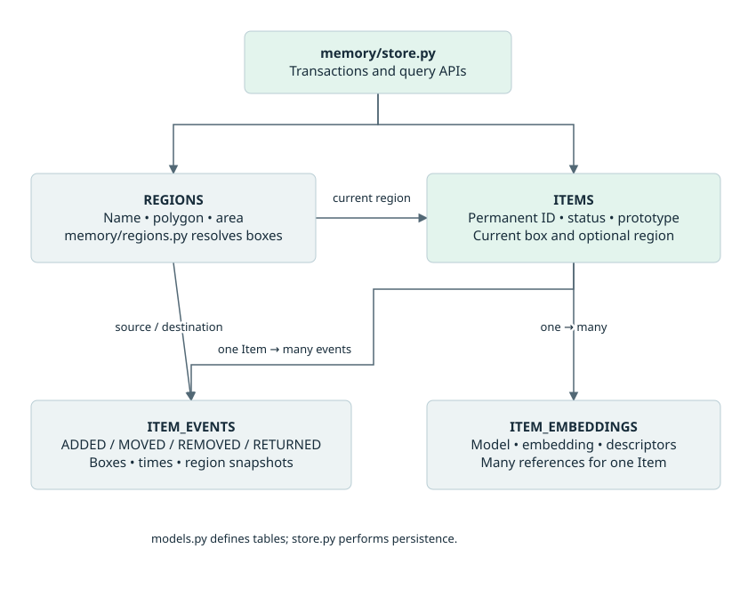

# Data model and contracts

## Persistent entities



```text
items (permanent identity)
  | 1                       | 1
  +----< item_events        +----< item_embeddings
         meaningful history        model-specific references

regions (logical polygons)
  +----< items.current_region_id
  +----< item_events.source_region_id / destination_region_id

negative_examples (views a person said are not items; belongs to no item)
```

| Table | Principal fields | Purpose |
| --- | --- | --- |
| items | id, class_name, display_name, status, first_seen_at, last_seen_at, identity_confidence, item_prototype, current_region_id, current_box, created_at, updated_at | Durable physical-object identity and current stored state |
| item_events | id, item_id, event_type, occurred_at, started_at, finished_at, source_track_id, detector_confidence, source_region_id, destination_region_id, source_region, destination_region, source_box, destination_box, source_box_area_fraction, destination_box_area_fraction, evidence paths, notes | Meaningful lifecycle and placement history |
| item_embeddings | id, item_id, model_name, embedding, aspect_ratio, color_histogram, object_image_path, created_at, confirmed | JSON reference vectors with optional supplementary descriptors; confirmed is true only for a view a person picked from a question |
| regions | id, unique name, polygon, area_px, created_at | Fixed-frame integer polygons with stored shoelace area |
| negative_examples | id, model_name, embedding, aspect_ratio, color_histogram, object_image_path, created_at | Views a person marked "not an item" (a hand, the table). No foreign key; written only, nothing compares against them yet |

Items have one-to-many relationships to the event and embedding tables; negative_examples has no relationship to any item and survives item deletion. Foreign keys are enabled for every store connection. Deleting an item cascades to its events and embeddings. SQLAlchemy string enums constrain stored status/event values. Indexes include event item/time and embedding item/model lookup pairs.

Evidence fields hold object-image, context-image, or video-clip paths, not binary media. Their presence in the schema does not mean the live pipeline writes every kind of evidence file. The identification worker now writes a thumbnail for each stored reference view (item_embeddings.object_image_path, a path relative to `data/reference_images/`, which is git-ignored; views stored before 16 October 2026 have none); item_events evidence paths are still unfilled. Negative examples store no picture. The separate diagnostic recorder can save raw/masked resolve crops under its run directory; those files are not linked to lifecycle evidence columns.

## States and events

| Trigger | Resulting status | Persisted event |
| --- | --- | --- |
| Confirmed view resolved as new | present | added |
| Existing removed identity matched | present | returned |
| Existing present identity matched | Unchanged | None; associate track only |
| Existing occluded identity matched | Unchanged by association path | None; automatic occlusion restoration is not wired |
| Known track completes stable movement | present | moved |
| Known stable/moving track absent beyond timeout | removed | removed |
| Explicit store status operations | present or occluded as requested | status_changed where applicable |

Occluded is a modeled status with store operations, but the live tracker does not emit general occlusion/status-change behavior. Absence heuristics therefore cannot reliably distinguish a long occlusion from physical removal.

## Persistence semantics

`add_item_with_event()` commits a new item and its initial event together. Status and movement operations update the item and append the event transactionally. Event intervals require both timezone-aware endpoints in chronological order. Bounding boxes are stored separately from optional semantic regions. History is returned chronologically, and present-item queries include occluded items.

`last_seen_at` is updated by store operations; it is not a continuously persisted per-frame heartbeat. Location information is event-oriented, especially movement source/destination boxes. Item.current_box/current_region_id now store the latest meaningful spatial belief. A pixel-space polygon resolver and temporary console queries are implemented; no world-coordinate calibration exists.

`save_item_embedding()` validates and normalizes a reference and updates the normalized-mean prototype atomically (an optional `confirmed` flag records that a person confirmed it). `add_negative_example()`, `count_negative_examples()` and `load_negative_embeddings()` keep and read the not-an-item views; `get_reference_image_path()` returns an item's newest thumbnail path. `add_reference_if_needed()` additionally enforces the caller's target count. `load_reid_gallery()` creates an independent float32 snapshot grouped by item, filtered by model and optionally status. Compatible model spaces and vector dimensions are required; changing preprocessing under the same model name is not fully captured by the schema.

## In-memory contracts

| Contract | Essential contents | Meaning |
| --- | --- | --- |
| Detection | Optional track_id, class_id/name, confidence, integer xyxy box | One frame's detector result |
| TrackSignal | Signal type, track_id, detection, optional item_id and movement metadata | Lifecycle proposal; ADD alone does not establish identity |
| PreparedReference | RGB PIL crop, normalized embedding, aspect ratio, color histogram | Usable masked view available for matching/saving |
| IdentityDecision | new/existing/pending, source_track_id, item_id, similarity, reference | Scene-processing proposal, not a committed database result |
| IdentificationJob | resolve/capture, track_id, optional item_id, frame, box, precomputed reference | Work crossing into the background thread |
| IdentificationResult | kind, track_id, status, item_id, similarity, reference, failure_reason | Worker result consumed by the coordinator |
| GalleryEntry | item_id, reference matrix, optional prototype, aspect_ratios and flattened color_histograms arrays | Matching snapshot for one permanent item |

Frames are uint8 BGR arrays shaped height x width x 3. Detection boxes use frame-pixel xyxy coordinates. SAM masks are frame-sized boolean arrays; True means retain the object. DINO input crops are RGB. Monotonic time measures lifecycle/cooldown durations, while event timestamps use UTC-aware datetimes at the API boundary.

## Schema evolution

Aspect and histogram descriptors are integrated through PreparedReference, worker capture, optional ItemEmbedding fields, and gallery arrays. Missing legacy descriptors are represented as NaN in gallery arrays; the matcher uses DINO-only scoring when both supplementary scores are not available. Histogram bin-layout/preprocessing version is not persisted; compatible capture conventions remain required.

**16 October 2026 (ask-and-answer flow):** `item_embeddings.confirmed` (boolean, not null, default false) and the `negative_examples` table are new. An existing database needs the one-time [manual SQL](manual_schema_update_ask_answer.sql) after a backup; every existing view becomes `confirmed = 0`. `DatabaseStore.missing_schema_columns()` reads the database without changing it, and `run_app` stops at startup with an instruction naming the script if a column is missing, instead of failing later with a bare "no such column". The script was run against a copy of the live file (15 items, 32 views, all kept; gallery loads) and not against the live file itself. A missing table is not a problem: `create_all` creates it, which is additive.

`create_schema()` calls Base.metadata.create_all: missing tables are created, existing tables are not altered. Existing databases need deliberate schema migration or an explicitly chosen fresh database. No automatic migration, destructive reset, or schema-version framework is provided. The inspected-schema [manual SQL](manual_schema_update.sql) covers eight missing nullable columns and region indexes; it was tested on a copy but not applied to the live file in this session. Always reinspect before using it; see [startup incident and recovery](09-operations.md).

## Spatial state and historical relationships

All region FKs use ON DELETE SET NULL; historical event strings survive region deletion/renaming. ADD/MOVED/RETURNED set current_box/current_region_id and update last_seen_at within the event transaction. REMOVED preserves source evidence and clears current fields. The generic record_event API remains an append-only historical operation rather than a live-state transition. Store queries distinguish current contents, historical associated items, and event activity by their respective item/event FKs. Full field semantics, normalized-area formula, conservative legacy fallback, and API signatures: [region memory](11-regions.md).

Sources: [models](../src/project_auto/memory/models.py), [store](../src/project_auto/memory/store.py), [event engine](../src/project_auto/events/event_engine.py), [job contracts](../src/project_auto/events/identification.py).

## Diagnostic data outside SQLite

The separate diagnostic launcher writes queries.csv, candidates.csv, outcomes.csv and crops under logs/reid_runs/run_id. query_id links scored evidence to the outcome applied by the coordinator. Ground-truth labels still need human input. Normal tracking does not create these diagnostic files.
